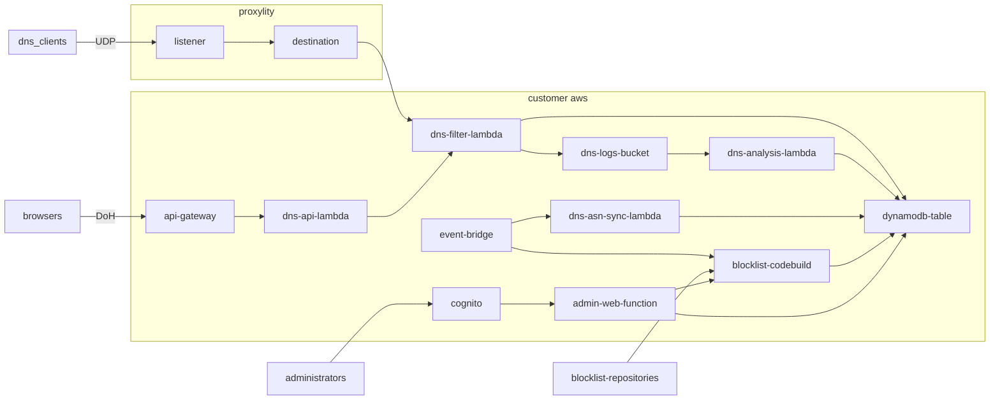
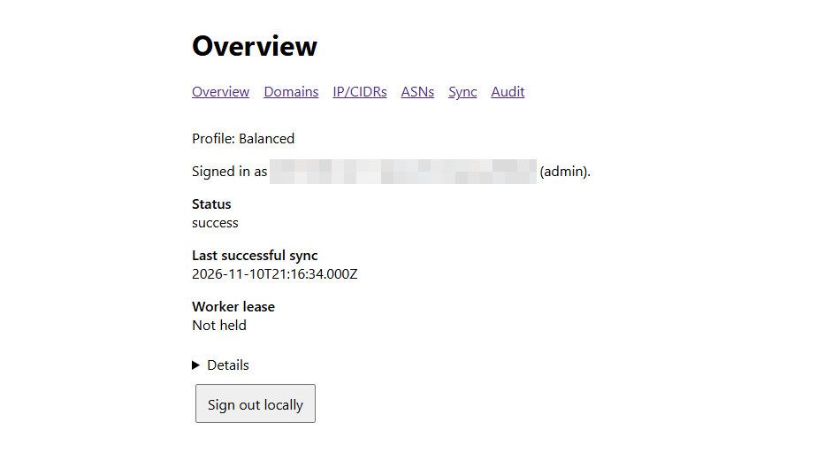
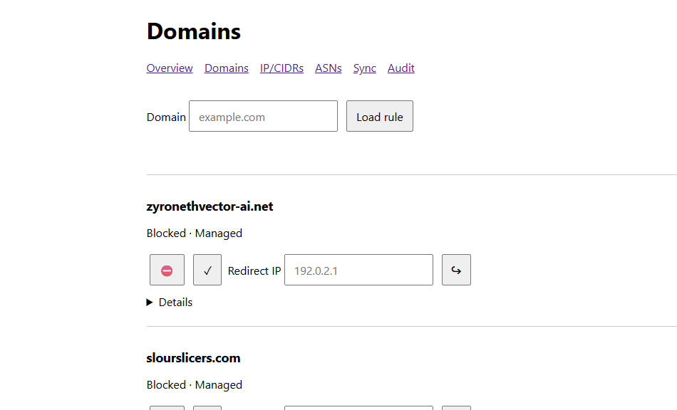
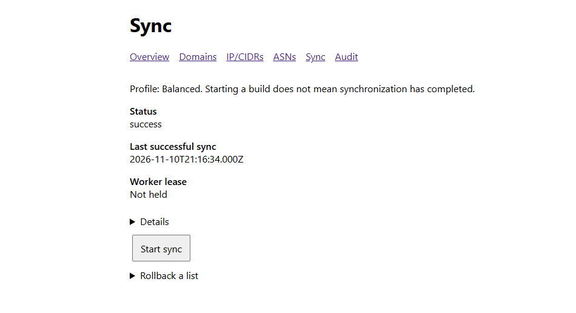

# DNS Filter

A DNS service you run in your own AWS account. It provides UDP and DNS over HTTPS (DoH) endpoints. DoH is optional and, if enabled, requires a registered domain name and a hosted zone (see [Configuration options](#configuration-options)). It can block (NXDOMAIN) and redirect (override the IP) both domain names and Autonomous Systems (by ASN), and it can optionally log DNS queries and analyze them for suspicious activity (enabled by default). The system is serverless and scales with demand. KMS keys, retained storage, scheduled builds, and identity services can incur baseline charges. A subscription to Proxylity UDP Gateway is required to deploy it.

This DNS resolver:

* Blocks domains by returning a "nonexistent domain" (NXDOMAIN) response for queries to them.
* Redirects domains by returning a specified IP address (to a portal, for example) for matching queries.
* Blocks or redirects by Autonomous System Number (ASN) by examining upstream DNS responses and matching the IPs they return to ASNs.
* Blocks or redirects by IP address or CIDR network in upstream answers.
* Imports curated blocklists on a schedule (HaGeZi domains, Spamhaus DROP networks) and lets administrators override them from an authenticated web UI.
* Supports traditional UDP-based DNS that is used by most devices and operating systems.
* Supports DNS over HTTPS (DoH) for use in browsers ([RFC 8484](https://datatracker.ietf.org/doc/html/rfc8484)).
* Proxies unmatched DNS requests to an upstream DNS service of your choice (default is 1.0.0.3). The upstream DNS will see a public AWS IP address as the client rather than your own (enhancing privacy).
* Incurs low usage-based costs (free when within the AWS and Proxylity free tiers).

> **NOTE**: This service provides UDP-based DNS on a non-standard port (i.e. not port 53). Unfortunately, Windows doesn't allow configuring DNS servers on an alternate port (Linux does with `dnsmasq`), so a network level configuration is required to use it (DNAT at the router). On hardware that supports it like Cisco (IOS/IOS-XE), DNAT can be used to redirect traffic bound to port 53 to this service. Other network hardware like Juniper Mist and Palo Alto have UI and/or API based configuration methods to support something similar. Meraki MX does not appear to support this since it lacks DNAT.

## Why?

This project is motivated by some simple realities:

* DNS is a foundational service required to use the internet effectively.
* DNS abuse detection and filtering is a capability that protects users and networks from undesirable content, malfeasance, misuse and abuse.
* There are legitimate privacy concerns around using DNS services provided by ISPs and others who may collect DNS information to build user profiles and sell them to third parties.

## System diagram



## Deploying

> **NOTE**: The account in which you deploy **must be subscribed to Proxylity UDP Gateway**, which is available in [AWS Marketplace](https://aws.amazon.com/marketplace/pp/prodview-cpvl5wgt2yo2e). Subscribing is free and you will only be billed for Listeners you create and traffic delivered to Destinations you configure. For personal use it is likely that this service will operate within the AWS and Proxylity free tiers. For more information see [proxylity.com](https://proxylity.com/landing/love.html).

### Requirements

Use Linux or WSL 2 with Bash, .NET 10, Node.js 24/npm, Git, `tar`, `zip`, `sha256sum`, AWS CLI, SAM CLI, and `jq`. Authenticate the AWS CLI with a deployment identity authorized to create the stacks, pass their execution roles, start CodeBuild, and use the artifact S3/KMS resources.

[`dnsstress`](https://mickaelbergem.github.io/dnsstresss/) is optional for load testing and not required for deployment.

[publish.sh](./scripts/publish.sh) builds the self-contained Linux worker once. CodeBuild downloads a pinned S3 object version, checks its SHA-256, and runs it without installing .NET or compiling. The UI archive includes its locked npm dependencies.

### Artifact buckets

Deployment uploads the sync worker and admin UI archives to an encrypted, versioned S3 bucket in each deployment region. Run [prerequisites.sh](./scripts/prerequisites.sh) to create these through the [artifact template](./templates/dns-filter-artifacts.template.json), or supply existing buckets with equivalent controls. Existing buckets must have versioning and a customer-managed default SSE-KMS key expressed as an ARN.

The admin UI is a Lambda Web Function. Web Functions read their code using the **Lambda service principal**, independently of the application's execution role. The artifact bucket must therefore allow `lambda.amazonaws.com` to call `s3:GetObject` and `s3:GetObjectVersion` for the admin archive prefix, scoped to the admin function's revision ARN. The artifact KMS key must also allow service-principal `kms:Decrypt` through S3. The [artifact template](./templates/dns-filter-artifacts.template.json) provides these grants when `AdminFunctionName` is set, with `AdminArtifactPrefix` selecting the archive prefix. New buckets provisioned by the prerequisites script receive these parameters from `STACK_NAME` and `DEPLOY_BUCKET_PATH_PREFIX`.

For an existing bucket created by that template, update its **existing artifact stack** before deploying the UI (substitute your original bucket and stack names):

```bash
aws cloudformation deploy --no-fail-on-empty-changeset \
  --template-file templates/dns-filter-artifacts.template.json \
  --stack-name "dns-artifacts-${AWS_REGION}" --region "$AWS_REGION" \
  --parameter-overrides BucketName="${DEPLOY_BUCKET_NAME_PREFIX}${AWS_REGION}" \
    AdminFunctionName="${STACK_NAME}-admin" \
    AdminArtifactPrefix="${DEPLOY_BUCKET_PATH_PREFIX:-builds}/${STACK_NAME}/admin/"
```

Selecting existing buckets in the prerequisites script only validates encryption and versioning; it does not update policies. For externally managed buckets, have their owner merge the equivalent S3/KMS grants into their policies. Do not create a second CloudFormation stack to manage the same bucket. Keep these grants aligned if you change the admin function name or artifact prefix.

### Configuration options

Defaults are set in [configure.sh](./scripts/configure.sh), and each value can be overridden with an environment variable.

| Variable | Default | Purpose |
|---|---|---|
| `ALLOWED_IPS` | your current public IP (`/32`) | CIDR allowed to use the UDP and DoH endpoints. Use `0.0.0.0/0` for unrestricted access. Set it explicitly for stable updates. |
| `DEPLOY_BUCKET_NAME_PREFIX` | placeholder (must be set) | Prefix of the artifact buckets; the region is appended. |
| `DEPLOY_BUCKET_PATH_PREFIX` | `builds` | S3 key prefix for deployment artifacts. |
| `STACK_NAME` | `dns-filter` | Name of the stacks. |
| `BLOCKLIST_PROFILE` | `Balanced` | Managed blocklist profile (`Light`, `Balanced`, `Strict`). |
| `SYNC_SCHEDULE` | `rate(8 hours)` | EventBridge schedule for the blocklist sync. |
| `SYNC_ENABLED` | `true` | Set to `false` to disable scheduled and post-deploy syncs. |
| `SYNC_WORKER_MODE` | `sync` | `sync` imports data. `validate` only validates configuration. |
| `ENABLE_ADMIN_UI` | `true` | Deploy the admin UI stack. |
| `OPERATIONAL_LOG_RETENTION` | `30` | Days to keep operational (Lambda, CodeBuild) logs. |
| `DNS_LOG_RETENTION` | `30` | Days to keep DNS query logs. `0` disables query logging, analysis and notifications. |
| `SUSPICIOUS_DOMAIN_EMAIL` | empty | Optional address for [suspicious-domain notifications](#suspicious-domain-email-notifications). |
| `DOMAIN_NAME`, `HOSTED_ZONE_ID` | unset | Optional custom DoH domain. `DOMAIN_NAME` is the full hostname (for example `doh.example.com`) and the endpoint is `https://<DOMAIN_NAME>/dns-query`. The domain must be registered and have a Route 53 hosted zone. |

The three managed profiles differ in their domain lists:

| Profile | HaGeZi domain list | FireHOL IP list |
|---|---|---|
| Light | Light | Spamhaus DROP |
| Balanced (default) | Multi Normal | Spamhaus DROP |
| Strict | Pro | Spamhaus DROP |

Review upstream licensing/attribution and the impact of blocking advertising, telemetry, and whole IP networks before deployment.

### Clone this repo

```bash
git clone https://github.com/proxylity/examples && cd ./examples/dns-filter
```

### First installation

Run the following from the cloned `dns-filter` directory.

1. Choose the home region and verify the AWS account:

   ```bash
   export AWS_REGION=us-west-2
   export AWS_DEFAULT_REGION="$AWS_REGION"
   export STACK_NAME=dns-filter
   aws sts get-caller-identity
   ```

   The home region must be one of the configured deployment regions. The scripts currently use `us-west-2`, `us-east-1`, and `eu-west-1`. Changing these requires coordinating [configure.sh](./scripts/configure.sh), the region list in [prerequisites.sh](./scripts/prerequisites.sh), and the global-table replicas in the [global template](./templates/dns-filter-global.template.json).

2. Create or select the artifact buckets:

   ```bash
   bash scripts/prerequisites.sh
   export DEPLOY_BUCKET_NAME_PREFIX="your-selected-prefix-"
   ```

   Use the prefix printed by the prerequisites script, including its trailing hyphen. Running it with `bash` does **not** export that value into your current shell, so the explicit `export` is required. Bucket names are the prefix plus the region, for example `your-selected-prefix-us-west-2`. Existing buckets must pass the script's versioning and customer-managed SSE-KMS checks.

3. Review the [configuration options](#configuration-options) and set any overrides:

   ```bash
   export ALLOWED_IPS="203.0.113.10/32" # Replace with your network's public CIDR
   export BLOCKLIST_PROFILE=Balanced
   export SYNC_ENABLED=true
   export SYNC_WORKER_MODE=sync
   export ENABLE_ADMIN_UI=true
   export DNS_LOG_RETENTION=30
   export SUSPICIOUS_DOMAIN_EMAIL="" # Optional organizational alert address
   ```

4. Build and deploy everything:

   ```bash
   bash scripts/deploy.sh
   ```

   [deploy.sh](./scripts/deploy.sh) runs [publish.sh](./scripts/publish.sh) automatically: it compiles and packages the self-contained worker and the Node UI. It then deploys the global stack, builds the regional Lambdas with SAM, uploads pinned worker/UI artifact versions, deploys the home-region sync and optional admin stacks, and deploys each regional stack with the assigned UI origin. No separate publish or load command is required.

5. Complete setup and verify.

   When the UI is enabled, retrieve its outputs:

   ```bash
   export USER_POOL_ID=$(aws cloudformation describe-stacks \
     --stack-name "${STACK_NAME}-admin" --region "$AWS_REGION" \
     --query 'Stacks[0].Outputs[?OutputKey==`UserPoolId`].OutputValue | [0]' --output text)
   export ADMIN_URL=$(aws cloudformation describe-stacks \
     --stack-name "${STACK_NAME}-admin" --region "$AWS_REGION" \
     --query 'Stacks[0].Outputs[?OutputKey==`AdminUrl`].OutputValue | [0]' --output text)
   ```

   Invite an administrator as described in [Admin UI access](#admin-ui-access), open the UI, and complete MFA setup. If notifications are enabled, confirm the SNS subscription email in each region.

   Deployment starts an initial CodeBuild sync when `SYNC_ENABLED=true`, but does not wait for it to finish. Check CodeBuild and the UI's sync status for a successful build and `SYNC#STATE` checkpoint before expecting managed blocking. `SYNC_WORKER_MODE=validate` does not import any entries.

The UDP endpoint and table name are saved in `global-stack-outputs.json`, which `deploy.sh` generates in the `dns-filter` directory (it is not part of the repository). Extract values for testing:

```bash
export DNS_DOMAIN=$(jq -r .Domain global-stack-outputs.json)
export DNS_PORT=$(jq -r .Port global-stack-outputs.json)
export DNS_ENDPOINT=$(jq -r .Endpoint global-stack-outputs.json)
export DNS_TABLE=$(jq -r .TableName global-stack-outputs.json)
```

### Admin UI access

The [admin stack](./templates/dns-filter-admin.template.json) is deployed in two passes: first it creates a revision and endpoint using a placeholder origin (`https://example.invalid`, so login cannot complete), then it binds the assigned HTTPS origin into the revision and the Cognito callback URL. The endpoint always has explicit revision weights, including during bootstrap. No request-derived Host header determines authentication redirects.

On a new deployment, invite users with the pool ID from the admin stack outputs:

```bash
aws cognito-idp admin-create-user --user-pool-id "$USER_POOL_ID" \
  --username admin@example.com --user-attributes Name=email,Value=admin@example.com
aws cognito-idp admin-add-user-to-group --user-pool-id "$USER_POOL_ID" \
  --username admin@example.com --group-name admin
```

Use the `viewer` group for read-only access. For enterprise federation, configure a SAML/OIDC provider in the retained pool, select its name through the admin template's `IdentityProviderNames` parameter, and assign authorized users to these groups. Self-registration is not enabled. Sessions expire no later than the ID token, and group changes take effect at the next login.

The admin encryption key grants the Lambda service decrypt access scoped to this Web Function's revision ARN and encryption context. The deployment identity also needs `kms:DescribeKey`, `kms:GenerateDataKey`, and `kms:Decrypt` for revision creation. Execution-role access alone does not authorize the deployment.

### Suspicious-domain email notifications

Set `SUSPICIOUS_DOMAIN_EMAIL` before deployment (regional template parameter `SuspiciousDomainEmail`). When it is nonempty and query logging is enabled, each regional stack creates an encrypted SNS topic, an email subscription, and an EventBridge rule for the analyzer's `suspicious-domain` events. Confirm the SNS subscription email **in each region** before expecting alerts. Leaving the parameter empty creates none of these notification resources. Setting `DnsLogRetentionDays=0` disables analysis and these notifications.

Emails include the domain, detection reasons, query/NXDOMAIN counts, region, and time. Deployment supplies the UI origin through the regional `AdminUrl` parameter. The link opens an exact-key lookup with a prefilled rule form and survives login. An `admin` must review and submit **Block**. Opening a link never changes policy, and viewers cannot create blocks. Existing rules are displayed for deliberate editing rather than overwritten automatically. Without a UI origin, emails still arrive but omit the link.

The analyzer persists `IsSuspicious` with domain state, so normal subsequent analysis does not re-alert an already flagged domain. State expires after seven days without updates, after which renewed activity can generate another alert. EventBridge/SNS delivery is at least once: retries, concurrent analysis, or a failure between event acceptance and state persistence can produce duplicates. Email is not a guaranteed incident-delivery channel, so monitor regional analysis logs and EventBridge delivery metrics. Notifications disclose detected domains to the subscribed mailbox, so choose an appropriate organizational address.

Existing `/rules?kind=domain&value=...` notification links remain supported and open the Domains view. New navigation uses `/domains`, `/ip-cidrs`, and `/asns`. Login returns and background lookups preserve the selected page.

### Deploying updates

Update the source to your desired revision, retaining any intentional local configuration edits. From the same `dns-filter` directory, authenticate to the **same AWS account**, restore the original home region, stack name, artifact prefix, and deployment options, then rerun:

```bash
export AWS_REGION=us-west-2
export AWS_DEFAULT_REGION="$AWS_REGION"
export STACK_NAME=dns-filter
export DEPLOY_BUCKET_NAME_PREFIX="your-selected-prefix-"
# Restore your ALLOWED_IPS and other original options, changing only what you intend.
bash scripts/deploy.sh
```

This rebuilds and uploads application artifacts and updates the existing CloudFormation/SAM stacks. Empty changesets are accepted. Do not run teardown or recreate the buckets to deploy an update. Run [prerequisites.sh](./scripts/prerequisites.sh) again only if the artifact buckets need provisioning or validation. Existing policy records, sync metadata, and Cognito users are not deliberately reset by redeployment. Review template changes for replacements or migrations before applying them to production.

Keep the same stack, account and region identifiers: changing them is a different deployment, not an update. Keep optional configuration explicit across runs. In particular, an empty `SUSPICIOUS_DOMAIN_EMAIL` removes notification resources, and `ENABLE_ADMIN_UI=false` skips deploying the admin stack but does **not** delete an existing UI. Changing the profile triggers managed membership reconciliation on the next successful sync, while customer-owned rules remain protected.

The deployment script requests a sync again when enabled. If that final request hits CodeBuild's concurrent-build limit, deployment reports a warning instead of failing the completed stack deployment. The request is not retried automatically, so inspect existing builds and request another sync after they finish if necessary. Other StartBuild errors still fail the script.

After an update, check stack completion, the new CodeBuild build, UI login, DNS responses, and notifications. Routine upstream feed updates need no redeployment because the EventBridge schedule already runs them. For an extra sync, use the UI or run [load.sh](./scripts/load.sh), which starts a build rather than a deployment.

## Using the admin UI

The [admin UI](./src/dns-admin-web/) is where you manage policy day to day. Sign in at the `AdminUrl` stack output. Members of the `admin` group can change policy and start syncs. Members of `viewer` have read-only access.



* **Domains, IP/CIDRs and ASNs** each have their own page with a type-specific lookup field. Type a value and pause: the UI performs an exact lookup in the background and shows the current rule, or offers to create one if none exists. A **Load rule** button does the same without JavaScript.
* **Rule actions** are **Allow**, **Block** and **Redirect** (to an IP address). Customer rules can also be deleted. Managed (imported) rules cannot be deleted. Instead, create an override, which takes ownership of that entry for your deployment.
* **Browsing** a page lists rules of that type in pages. Browsing uses bounded scans, so prefer exact searches in large deployments.
* **Sync** shows the status of the last sync and lets an admin start one immediately or roll a list back to a cached commit. Starting a build does not mean synchronization has completed. Rollback requires an available cached commit and is superseded by the next scheduled sync. Disable the schedule if you need to hold a rollback.
* **Audit** lists every policy change with the actor and time.

<br/>


Behavior to know about:

* An explicit customer **Allow** stops less-specific domain or IP feed matches. It does not override a more-specific block or bypass the other domain, IP and ASN filtering stages.
* Changes become visible after replication and cache expiry (up to five minutes for resolvers).
* A redirect target applies to one address family. If a redirect matches a record of the other family (for example an IPv4 redirect matching an AAAA answer), that record is removed instead of being returned, so clients only see the redirected family. Create redirects for both families if you need both.
* Deleting an override does not automatically reapply an unchanged upstream entry.
* Update policy only in the home region. Global-table condition expressions do not coordinate concurrent cross-region writes.
* Login uses Cognito managed login with MFA, sessions are stored in encrypted HttpOnly cookies, and all changes are protected by CSRF tokens and server-side `admin`/`viewer` authorization.

## Advanced: Direct DynamoDB access

Policy is stored in the DynamoDB table (`DNS_TABLE`), so you can also read and write rules directly. Items you create this way have no ownership marker and are treated as customer-owned, which means managed syncs never overwrite them. The UI is preferred because it also records an audit entry and guards against concurrent edits. Direct writes bypass both.

* **To block a domain:**
  Add an item with the PK and SK both set to the domain name and the attribute `blocked` set to `true`. A domain can be a fully qualified domain name (FQDN) like www.cheese.com, a root domain like cheese.com (which blocks it and all subdomains) or even a top level domain like .io (which blocks any domain on that TLD).

  ```bash
  aws dynamodb put-item --table-name ${DNS_TABLE} \
    --item '{"PK":{"S":"cheese.com"},"SK":{"S":"cheese.com"},"blocked":{"BOOL":true}}'
  ```

* **To redirect a domain:**
  Add a domain as above, but instead of the `blocked` attribute set the `redirect` attribute to the IP address that should be returned when that domain is requested.

  ```bash
  aws dynamodb put-item --table-name ${DNS_TABLE} \
    --item '{"PK":{"S":"cheese.com"},"SK":{"S":"cheese.com"},"redirect":{"S":"127.0.0.1"}}'
  ```

* **To block or redirect an ASN:**
  Add an item with the PK and SK both set to `AS#{AsnNumber}`, the index attributes shown below, and `blocked` set to `true` or `redirect` set to an IP address. Any DNS lookup that returns an IP managed by that ASN is rewritten to return the unroutable IP or the redirect IP. ASN blocks are applied by an hourly job. To apply a new record immediately, run the `dns-asn-data` function in each region to rebuild the lookup data.

  ```bash
  # To block an ASN (returns an unroutable IP)
  aws dynamodb put-item --table-name ${DNS_TABLE} \
    --item '{
      "PK": {"S": "AS#44901"},
      "SK": {"S": "AS#44901"},
      "GSI1PK": {"S": "BLOCKED_ASNS"},
      "GSI1SK": {"S": "44901"},
      "asn": {"N": "44901"},
      "blocked": {"BOOL": true}
    }'

  # To redirect an ASN to a specific IP
  aws dynamodb put-item --table-name ${DNS_TABLE} \
    --item '{
      "PK": {"S": "AS#44901"},
      "SK": {"S": "AS#44901"},
      "GSI1PK": {"S": "BLOCKED_ASNS"},
      "GSI1SK": {"S": "44901"},
      "asn": {"N": "44901"},
      "redirect": {"S": "127.0.0.1"}
    }'
  ```

IP and CIDR rules use `IP#<canonical-network>/<prefix>` as the PK and SK, with the network in canonical form (for example `IP#192.0.2.0/24`, or a lowercase compressed IPv6 address). Use the UI to create these unless you are sure of the canonical form.

Managed domains and IP networks are imported by the scheduled sync worker. No ASN policies are imported automatically.

## Testing

To test DNS over HTTPS in your browser, navigate to the security settings page and enable "Use Secure DNS". Enter the full URL of the endpoint, including the scheme `https://` and the path `/dns-query`.

Wait for the initial managed sync to succeed, or create a customer-owned test block in the UI. Use `nslookup` to verify that an allowed domain resolves normally and that your chosen blocked domain returns NXDOMAIN. Upstream list contents change, so use an exact rule lookup to verify the test domain is currently blocked rather than relying on the historical examples below. The addresses and ports in these examples are placeholders.

```bash
$ nslookup -port=${DNS_PORT} google.com ${DNS_DOMAIN}
Server:         dns.example.com
Address:        203.0.113.10#10053

Non-authoritative answer:
Name:   google.com
Address: 198.51.100.20
Name:   google.com
Address: 2001:db8::20
```

```bash
$ nslookup -port=${DNS_PORT} 000free.us ${DNS_DOMAIN}
Server:         dns.example.com
Address:        203.0.113.10#10053

Non-authoritative answer:
Name:   000free.us
Address: 0.0.0.0
Name:   000free.us
Address: 0.0.0.0
```

If you have `dnsstress` installed, it can be used to demonstrate the robustness and scalability of UDP Gateway based DNS. Be aware that this kind of load testing can produce significant costs over time. Here are a couple of example runs:

```bash
$ go/bin/dnsstresss -concurrency 100 -r ${DNS_ENDPOINT} google.com
dnsstresss - dns stress tool

Testing resolver: dns.example.com:10053.
Target domains: [google.com.].

Started 100 threads.
Requests sent:     90r/s        Replies received:     90r/s (mean=177ms / max=334ms)
Requests sent:    340r/s        Replies received:    340r/s (mean=277ms / max=1184ms)
Requests sent:    400r/s        Replies received:    400r/s (mean=313ms / max=1254ms)
Requests sent:    500r/s        Replies received:    500r/s (mean=215ms / max=381ms)
...
```

Lookups of blocked domains are much faster due to caching:

```bash
$ go/bin/dnsstresss -concurrency 100 -r ${DNS_ENDPOINT} 000free.us
dnsstresss - dns stress tool

Testing resolver: dns.example.com:10053.
Target domains: [000free.us.].

Started 200 threads.
Requests sent:   1155r/s        Replies received:   1155r/s (mean=110ms / max=176ms)
Requests sent:   1855r/s        Replies received:   1855r/s (mean=109ms / max=212ms)
Requests sent:   1874r/s        Replies received:   1874r/s (mean=116ms / max=234ms)
Requests sent:   1730r/s        Replies received:   1730r/s (mean=118ms / max=212ms)
...
```

### Using the service from a Linux host

On a Linux system `dnsmasq` provides a convenient way to configure DNS on a non-standard port. For example, to route all local DNS requests to your endpoint (use the values of `DNS_DOMAIN` or its IP address, and `DNS_PORT`):

```
# Install dnsmasq
apt update && apt install dnsmasq

# Configure dnsmasq to forward to your DNS service
cat > /etc/dnsmasq.d/custom-dns.conf << EOF
# Listen on localhost port 53
listen-address=127.0.0.1
port=53

# Forward all queries to your DNS service (replace with your endpoint address and port)
server=203.0.113.10#10053

# Don't read /etc/hosts
no-hosts

# Don't read /etc/resolv.conf
no-resolv

# Cache size
cache-size=1000
EOF

# Disable systemd-resolved if it's running
systemctl stop systemd-resolved
systemctl disable systemd-resolved

# Update /etc/resolv.conf to use localhost
echo "nameserver 127.0.0.1" > /etc/resolv.conf

# Start dnsmasq
systemctl enable dnsmasq
systemctl start dnsmasq

# Test
dig example.com
```

## Operations and validation

* **Encryption.** Regional data buckets and operational logs use rotating customer-managed KMS keys. Query-log delivery is explicitly encrypted. Existing objects are not retroactively re-encrypted. Global-table point-in-time recovery remains enabled and uses DynamoDB KMS encryption.
* **Retention.** Query and operational log retention are separate settings. Regional Lambda logs use explicit stack-scoped groups (`/aws/lambda/<stack-name>/<function-name>`) to avoid colliding with automatically created default groups from earlier deployments. Existing default groups are not imported or deleted, so review their retention and cleanup separately.
* **Monitoring.** CloudWatch dashboards show DNS health, DynamoDB consumption, and synchronization builds and duration. Alarms report resolver errors, failed builds, and missing successful builds. Connect alarm actions to your organization's notification destination.
* **Sync metrics.** Worker summaries emit `DnsFilter/Sync` metrics (`Added`, `Removed`, `ProtectedConflicts`, `Success`, `Duration`) without domain or IP dimensions.
* **Privacy.** DNS queries are privacy-sensitive. Operational logs do not record queried domain names, packet or DoH payloads, or client IP addresses. The optional query logs are kept in the region that handled the query and contain domain names but no client IPs. The upstream DNS service still sees forwarded queries.
* **Infrastructure-only rollout.** `SYNC_WORKER_MODE=validate` or `SYNC_ENABLED=false` lets you deploy the infrastructure first: the worker validates configuration without importing data or advancing a sync checkpoint. Production `sync` mode is the default. The deployment's initial StartBuild is asynchronous, so verify actual build completion and `SYNC#STATE` before relying on feed protection.

Run the tests with:

```bash
TABLE_NAME=test-table BUCKET_NAME=test-bucket dotnet test src/tests/tests.csproj
(cd src/dns-admin-web && npm ci && npm test)
```

Lint the templates using a CloudFormation schema set that supports `AWS::Lambda::WebFunction`, `WebFunctionRevision`, and `WebFunctionEndpoint`. Older SAM and cfn-lint installations do not recognize these new resource types. Local tests do not establish cloud-side outcomes, so validate the actual Web Function deployment, Cognito login and federation, KMS delivery, local-cache reuse and loss, and latency and cost in a test AWS account before production.

## Design notes

### Code layout

* Scripts in [scripts](./scripts/) automate deployment into your AWS account.
* CloudFormation templates configure the [global](./templates/dns-filter-global.template.json), [regional](./templates/dns-filter-region.template.json), [sync](./templates/dns-filter-sync.template.json), [admin](./templates/dns-filter-admin.template.json) and [artifact](./templates/dns-filter-artifacts.template.json) resources, including DynamoDB tables, API Gateways, Route 53 record sets, Lambda functions, EventBridge rules, CodeBuild projects, Cognito pools, and IAM roles and policies.
* C# code for the [DNS handler](./src/dns-filter-lambda/), [DoH handler](./src/dns-api-adapter-lambda/), [query log analysis](./src/dns-analysis-lambda/) and [ASN data processing](./src/dns-asn-data-lambda/) Lambda functions makes up the core of the system. The [blocklist sync worker](./src/dns-blocklist-sync/) is a separate C# program run by CodeBuild.
* The [admin UI](./src/dns-admin-web/) is a Node.js app.

### Resolver behavior

The resolver batches direct IP prefix lookups (up to 33 IPv4 or 129 IPv6 candidates) into requests of at most 100 keys and caches results for five minutes. This is DNS-answer filtering, not a network firewall. Benchmark IPv6 read cost and DNS latency with representative traffic before production rollout.

The hourly ASN mapping job paginates rules and writes correctly encoded IPv4 and IPv6 ranges. Warm resolver environments refresh that mapping every five minutes and retain their prior mapping on transient refresh errors.

### Query logging and analysis

When logging is configured, the log messages (which are very minimal and don't include client IP addresses) are kept in the region that handles the DNS request. The analysis Lambda function runs in the same region and works asynchronously on batches of query log messages for efficiency. It makes calculations on individual queries (stateless analysis) and keeps track of statistics for base domains (stateful analysis).

The number of "non-existent domain" (NXDOMAIN) responses, the total number of queries, and the number of unique subdomains are tracked in the global DynamoDB table across all regional stacks.

When new suspicious domains are identified, an event is sent to the default EventBridge bus with the following format:

```json
{
    "DetailType": "suspicious-domain",
    "Detail": {
        "Domain": "somedomain.tld",
        "TotalQueries": 0,
        "NxDomainCount": 0,
        "Reasons": [ "<Reason 1>", ... ],
        "ReasonSummary": "<Reason 1>; ...",
        "RulePath": "/rules?kind=domain&value=somedomain.tld"
    },
    "Source": "dns-filter"
}
```

### Managed blocklists

The home-region [sync stack](./templates/dns-filter-sync.template.json) runs the precompiled [C#/.NET 10 worker](./src/dns-blocklist-sync/) every 8 hours by default. HaGeZi and FireHOL are native CodeBuild GitHub sources using `LOCAL_SOURCE_CACHE`. `LOCAL_CUSTOM_CACHE` holds only an initialization marker. CodeBuild owns cloning and updating the checkouts.

Only the selected `wildcard/*-onlydomains.txt` and `spamhaus_drop.netset` files are processed. No ASN feed is imported, but manual ASN rules remain supported.

Normal updates parse only added and removed Git hunk lines from the last successful commit to the checked-out commit. Sorting and comment-only changes cancel out. The worker does not persist full entry lists. DynamoDB stores successful and pending commit and profile metadata. Pending deltas are completed before newer changes, so a failed build cannot strand partially applied entries. The next run catches up to the latest head. Local cache reuse is best-effort, even for scheduled jobs. Missing initialization metadata or old Git objects trigger an explicit full reconciliation. Newly enabled lists require a full initial import, and disabled lists are removed by managed membership without reparsing retained lists.

The catalog feeds must contain unique canonical entries. Bootstrap rejects duplicates, and hunk processing rejects duplicate net changes. Keep alternate formats with repeated or noncanonical entries out of the catalog.

Managed domain records retain the `PK = SK = domain` lookup shape. IP/CIDR keys are `PK = SK = IP#<canonical-network>/<prefix>`. Managed rows carry `managedBy = blocklist-sync`, a `sourceLists` string set, and sharded sparse `ManagedRecords` index keys. Concurrent conditional DynamoDB updates never overwrite unmarked customer rows. Removing one source does not remove protection supplied by another source. Conditional conflicts are reported.

The worker uses bounded concurrency (16 operations) with ordinary `UpdateItem` and conditional `DeleteItem` calls, not per-record transactions or a shared write lock. Throttling and transient service errors use bounded retries. CodeBuild's single-build limit and a renewable lease coordinate runs. Renewal failure cancels work, but individual writes are deliberately not fenced against an expired worker. Writes use standard rather than transactional capacity, including replica writes.

Legacy records from the old loader have no ownership marker and are deliberately treated as customer-owned. Do not relabel or delete them without an approved import manifest. [load.sh](./scripts/load.sh) now requests a managed sync rather than overwriting table items.

### Admin UI implementation

The UI uses Lambda Web Functions, Cognito managed login with MFA, encrypted HttpOnly cookies, CSRF protection, and server-side `admin`/`viewer` authorization. Policy changes are written in transactions together with an audit record. Exact rule searches use a single keyed read, and general browsing uses bounded scans. The UI uses native HTML controls, a system font, and touch-friendly buttons. Raw records are available in collapsed Details sections. Icon actions have accessible labels and tooltips. Editing a lookup disables previous actions until the new result loads, so a slow or failed request cannot leave active controls for an earlier key.

## Cleanup

Run the teardown script:

```bash
./scripts/teardown.sh
```

It deletes the admin, sync, regional and global stacks. For each regional DNS data bucket (`dns-data-<account-id>-<region>`) that is not empty, it asks whether to permanently delete the objects first. If you answer no, or there is no terminal to ask on, the objects are left in place.

Teardown retains the DynamoDB table, Cognito user pool, KMS keys, the regional data buckets and the artifact buckets. Review costs and delete these only after confirming backups and retention requirements. To remove a retained bucket, empty it (including all object versions for versioned buckets) and then delete it.

Artifact buckets created by `prerequisites.sh` are managed by the `dns-artifacts-<region>` CloudFormation stacks. Empty each bucket and then delete its stack. The stacks retain the buckets and KMS keys, so delete those separately if you no longer need them.

## Roadmap

DNS filtering is an important network service, and this example shows how to implement it in your own AWS account with little effort while providing full control over privacy, featuring scalability from zero to global demand, and excellent resiliency, all at a fraction of the cost of alternatives.

That said, some helpful capabilities are still missing from this project:

* More efficient indexed browsing of customer rules in very large deployments.
* Additional curated profiles and enterprise federation configuration examples.

This repo is open to pull requests.
