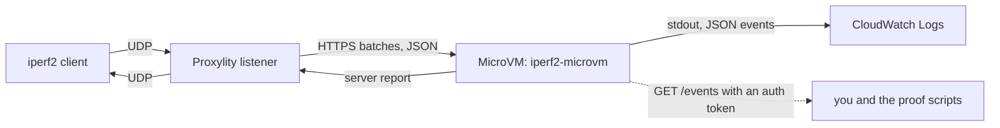

# iperf2 on Proxylity UDP Gateway with a Lambda MicroVM

> **Can you run an iperf2 server without running a server?**

This example answers standard iperf2 UDP tests (`iperf -u -c ...`) from an unmodified iperf2 client. The packets go to a Proxylity UDP Gateway listener, which delivers them in batches to a [Lambda MicroVM](https://docs.aws.amazon.com/lambda/latest/dg/lambda-microvms-guide.html). A small C# app compiled with NativeAOT keeps each test's statistics in memory and answers the client's FIN with a standard iperf2 server report.

There is no EC2 instance, container service, VPC, or cache. A Lambda function doesn't keep memory between invocations, so a function-based version needs every test's state in an external store (such as ElastiCache), with atomic scripts to merge concurrent batches and a replay step at the end to tell late packets from duplicates. A MicroVM keeps its memory between requests, so that state becomes a dictionary and a bitmap.



| iperf2 needs | How this example does it |
|---|---|
| A UDP endpoint | Proxylity listener |
| Datagram bytes, sender address | Proxylity batch JSON (`Data`, `Remote`, `Local`) |
| Arrival time | Each message's `ReceivedAt`, set by the gateway (never the VM clock) |
| Per-test state across packets | In-memory flow table in one long-lived MicroVM |
| Many tests at once | Flows keyed by remote IP, remote port, and listener port |
| Concurrent batch deliveries | One short lock around the flow table, and a 500 ms reorder buffer by `ReceivedAt` |
| The final report | Reply to the FIN, matched by `Tag` |

## What's supported

- Standard forward UDP tests (`iperf -u -c`): any `-t`, `-b`, `-l`, and `-P`, and many clients at once. Tested with the iperf 2.1.9 client, which uses 64-bit sequence numbers. Newer 2.x clients and the legacy 32-bit sequence layout are handled by the code and unit tests, but haven't been tested against a live client.
- Not supported (yet): reverse (`-R`) and full duplex, which will use a PacketSource whose SNS topic ARN is passed in `RunHookExtraData`. TCP, L4S, isochronous, and enhanced (`-e`) handshakes are also out of scope. iperf3 is a different protocol and won't work.

## How the statistics work

- **Loss.** The first FIN's sequence number `n` is the number of datagrams the client sent, counting that FIN. Loss is `n` minus the unique datagrams received, calculated only when the test ends, so a late datagram is never counted as lost.
- **FIN retries.** A stock client resends the FIN about every 10 ms for up to 2 s until it gets a report, and **each retry carries the next sequence number** (`-n`, `-(n+1)`, ...). The server uses the smallest one. It holds the report for 150 ms after the first FIN, so batches still in flight are counted, and then answers. That wait is measured on the MicroVM's own clock, because it's about delivery (processing time); `ReceivedAt` (event time) is only used for the statistics. It keeps the report for 10 s so later retries get the same answer.
- **Duplicates.** A bitmap per flow marks every sequence number seen, so duplicates are detected exactly and not counted. A stock iperf2 server does *not* do this: it counts a duplicate as received data, which can hide a real loss. See proof 1, scenario B.
- **Out-of-order and jitter.** These follow arrival order (`ReceivedAt`), not the order the HTTPS batches happen to be processed in. Packets wait in a 500 ms reorder buffer and are folded in oldest first. Jitter is the RFC 1889 estimator iperf2 uses: `J += (|D| - J) / 16`.
- **Cleanup.** Flows idle for 2 minutes are dropped. A stats line every 30 s shows what's in memory.

## Asking the MicroVM what it knows

The app writes one JSON event per batch, FIN, report, and periodic stats line. It prints them to stdout, which Lambda forwards to CloudWatch Logs (one stream per MicroVM, in the `MicrovmLogGroup` output), and also keeps the most recent 50,000 in memory. The proof scripts read the in-memory copy because it's available immediately, from the MicroVM itself, the same way Proxylity delivers packets: the MicroVM's HTTPS endpoint plus a short-lived auth token for port 8080 (`lambda:CreateMicrovmAuthToken`).

> **Log group name matters.** The image's `Logging` setting applies to the build. Running MicroVMs write their output to Lambda's default group, `/aws/lambda-microvms/<image-name>`, using the execution role, unless the destination's `RuntimeLogGroupName` argument names another group. This template uses the default name, so it needs no argument. If the execution role can't write to the group, runtime output is dropped without an error. To keep the output in one stream named after the tenant (`iperf2-1`), even across fresh MicroVMs, add `UseTenantIdForLogStreamName: "true"` to the destination's arguments.

```bash
scripts/status.sh                      # MicroVM ID, tenant, flows in memory, batches and packets processed
```

`GET /events?from=N&type=report` returns events numbered N and later. The proof scripts note the current number before a test and read everything after it. Every batch event also records the first and last raw `ReceivedAt` values exactly as delivered, and how many had no fractional seconds.

## Why a fixed TenantId?

Proxylity can start one MicroVM per tenant, with the tenant taken from the packet bytes (`TenantIdExpression`). That doesn't work for iperf2: a datagram carries no per-test identifier, and an expression only sees payload bytes, not the sender's address. A payload-derived tenant would split one test across several MicroVMs and break its statistics. So the destination uses a fixed `TenantId`: one MicroVM serves every test, separated in memory by flow.

The fixed ID is still useful. Changing it starts a fresh MicroVM with empty memory, without rebuilding anything: `scripts/fresh-vm.sh`.

## Repository layout

```
src/Iperf2.MicroVm/     the app: Program.cs (ports 8080 and 9000), BatchProcessor, FlowTable, Iperf2Protocol, Dockerfile
tests/Iperf2.Tests/     xUnit tests, including golden bytes captured from a stock iperf2 client and server
tools/LocalGateway/     a local stand-in for the gateway (batches UDP into the same JSON contract)
scripts/                publish, deploy, warmup, fresh-vm, teardown
scripts/prove/          the proof scripts (see below)
scripts/dev/            local test loops (no AWS needed) and troubleshooting tools
scripts/research/       the capture tools used to learn the wire protocol
template.yaml           SAM template: MicroVM image, roles, log groups, listener
```

## Prerequisites (WSL 2 or Linux)

- .NET 10 SDK and a C toolchain for NativeAOT (`clang`, or `gcc`, which `publish.sh` uses if clang is missing)
- iperf2 (`sudo apt install iperf`), `jq`, `xxd`, `zip`, `curl`
- AWS CLI v2 (a version with `lambda-microvms`) and SAM CLI, with credentials for us-west-2. Besides deploying the stack, the scripts call `lambda:ListMicrovms`, `lambda:GetMicrovm`, and `lambda:CreateMicrovmAuthToken` (to read the MicroVM's events), and `lambda:TerminateMicrovm` (`fresh-vm.sh`, `teardown.sh`).
- `sudo`, only for `scripts/prove/03-impairment.sh`, which uses `tc netem` (in WSL 2, the 6.6 kernel includes the `sch_netem` module)
- A Proxylity UDP Gateway subscription, and Lambda MicroVMs available in the region

> **Note**: `sam validate --lint` currently reports `AWS::Serverless::MicrovmImage` as an unknown resource type, because cfn-lint doesn't know the type yet. The template deploys normally.

## Try it locally first (no AWS)

```bash
dotnet test tests/Iperf2.Tests
scripts/dev/local-test.sh -t 5 -b 2M     # stock client -> local gateway -> app
scripts/dev/local-prove.sh               # deterministic proof plus the stock-server oracle
```

On a `/mnt/c` checkout, the scripts build in `~/iperf2-microvm` to stay clear of Windows build output.

## Deploy

```bash
scripts/deploy.sh
```

This publishes the native executable into `build/image/` with its Dockerfile, zips and uploads it, picks the newest base image version that supports the architecture, and deploys `template.yaml`. It allows only your current public IP address. Use `CLIENT_CIDR=203.0.113.0/24` to change that, and `RID=linux-arm64` to build for ARM64 MicroVMs (x86_64 needs base image version 3+). It prints the listener endpoint:

```bash
scripts/warmup.sh
iperf -u -c <domain> -p <port> -t 10 -b 1M
```

## Prove it

```bash
scripts/prove/run-all.sh             # IMPAIR=1 adds the netem test (needs sudo); FRESH=1 starts a new MicroVM first
```

Each proof checks a different source of truth, and a proof passes only when they agree. The evidence (every PASS/FAIL, raw client output, and the backend events used, read from the MicroVM) is written to `evidence/<timestamp>/`.

| Proof | What it shows |
|---|---|
| `00-preflight.sh` | Tools, credentials, outputs; the MicroVM answers, ran its `/run` hook, and receives `ReceivedAt` with sub-second precision |
| `01-deterministic.sh` | Bash-crafted datagrams with known faults; the report is exactly right, and the MicroVM logged the same bytes the client received. Scenario A must match a local stock iperf2 server exactly; scenario B shows where stock iperf2 lets a duplicate hide a loss |
| `02-stock-client.sh` | An unmodified client gets a normal server report, and the backend logged the same total, loss, and jitter |
| `03-impairment.sh` | Known loss, duplication, and reordering from `tc netem`; the measured rates match |
| `04-parallel.sh` | `-P 4` with 1200-byte datagrams and another client with 500-byte datagrams; five reports, none mixing a single datagram from another flow |
| `05-state.sh` | A slow 20 s test spans hundreds of deliveries to the same MicroVM with counts only increasing; afterwards the flow table is empty |

## Troubleshooting tools

| Script | Use it to |
|---|---|
| `scripts/status.sh` | Ask the running MicroVM what's in memory: its ID, tenant, flows, batches and packets |
| `scripts/dev/recent.sh` | See what the MicroVM did with each recent test: data received, how its FINs were handled, and its report |
| `scripts/dev/debug-image-build.sh` | Build the image outside CloudFormation, so a failed build keeps its reason and build log (`--cleanup` removes it) |

## Data handling

The app's events include each client's IP address and source port. They're kept in the MicroVM's memory (the most recent 50,000 events) and in CloudWatch Logs, which the template keeps for 7 days. Packet payloads aren't logged.

## Clean up

```bash
scripts/teardown.sh
```

This terminates the MicroVMs, which Proxylity started (so CloudFormation doesn't know about them), and then deletes the stack.

## Cost

Cost is driven by Proxylity packet charges and MicroVM time (the baseline memory size while running; a suspended MicroVM costs less). Set `LogBatches` to `false` in `RunHookExtraData` to stop recording an event per batch. Scale estimates with packets per second x test duration x concurrent flows.

It turns out the iperf2 server doesn't need to be a server.
