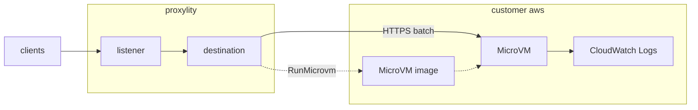

# Lambda MicroVM

This example delivers UDP packets from a Proxylity UDP Gateway listener to an [AWS Lambda MicroVM](https://docs.aws.amazon.com/lambda/latest/dg/lambda-microvms-guide.html). It is a minimal proof of concept: a small Node.js HTTP application runs inside the MicroVM, logs each packet it receives, and replies to the sender.

MicroVMs suit UDP workloads that need long-lived, in-memory state per client or tenant, a full Linux environment, or software that doesn't fit the Lambda function model. Unlike a Lambda function, the same MicroVM keeps serving requests (and keeps its memory) until it's suspended or terminated.

This example demonstrates:

* Building a MicroVM image from a `Dockerfile` with the `AWS::Serverless::MicrovmImage` SAM resource.
* Using a MicroVM image ARN as a listener destination.
* The JSON batch contract between Proxylity and an application running in a MicroVM.

## System Diagram



## How It Works

1. On deployment, Lambda builds a snapshot of the application in [src/echo-microvm](src/echo-microvm) from its `Dockerfile`.
2. When the first packet arrives, the Proxylity destination calls `RunMicrovm` to start a MicroVM from the image, with the execution role from the destination's `ExecutionRoleArn` argument. Lambda calls the app's `/run` hook (port 9000) with the MicroVM ID and a run hook payload from Proxylity (see [Run hook payload](#run-hook-payload)), and starts routing traffic once the hook returns. Proxylity then calls `CreateMicrovmAuthToken` to get a token, scoped to port 8080, for the MicroVM's HTTPS endpoint.
3. Packets are batched and `POST`ed to the MicroVM endpoint (port 8080) as JSON:

   ```json
   {
     "Messages": [{
       "Tag": "opaque-correlation-tag",
       "Remote": { "IpAddress": "203.0.113.10", "Port": 45678 },
       "Local": { "Domain": "ingress-1", "Port": 15678 },
       "Formatter": "base64",
       "Data": "aGVsbG8="
     }]
   }
   ```

4. The application responds with replies, each matched to a message by its `Tag`. Proxylity sends each reply back to the original sender:

   ```json
   { "Replies": [{ "Tag": "opaque-correlation-tag", "Data": "SGVsbG8gZnJvbSBNaWNyb1ZNLi4u" }] }
   ```

5. Later packets go to the same MicroVM. A MicroVM lives at most 8 hours. After that, or if it's terminated earlier, Proxylity starts a new one for the next packets. If a delivery fails, Proxylity checks the MicroVM's state: a terminated MicroVM is replaced and a suspended one is resumed, but a running one is left alone, so errors from the application never start new MicroVMs. A MicroVM that's terminated within 5 minutes of starting (for example, because its `/run` hook failed) isn't replaced for 5 minutes. If packets for a new tenant reach several Proxylity nodes at once, each may start a MicroVM. Only one is used and the others are terminated within seconds, so keep `/run` hooks free of side effects that assume they run once per tenant.

> **Note**: The first packet starts the MicroVM, so it may be dropped or answered late while the MicroVM reaches the `RUNNING` state. Send a few packets when testing.

## Deploying

> **Prerequisites**: AWS CLI (a version that includes the `lambda-microvms` commands), SAM CLI, `jq`, `zip` and `ncat` on a Linux (or WSL) system. You must be subscribed to Proxylity UDP Gateway, and Lambda MicroVMs must be available in the deployment region.

### SAM CLI support for MicroVM images

`AWS::Serverless::MicrovmImage` takes a local `CodeUri` (a directory with a `Dockerfile` and application code). At the time of writing, released SAM CLI versions can't yet zip and upload that directory during `sam deploy` ([aws/aws-sam-cli#9283](https://github.com/aws/aws-sam-cli/issues/9283)). Until that support ships, run [scripts/stage-microvm-code.sh](scripts/stage-microvm-code.sh) between `sam build` and `sam deploy`. It zips the source, uploads it to the SAM managed bucket, and points the built template at it. When SAM CLI handles this natively, skip the script.

### 1 — Build and deploy

The first time, deploy with `--guided` so SAM creates its managed bucket and saves your choices in `samconfig.toml`:

```bash
sam build
scripts/stage-microvm-code.sh
sam deploy --guided
```

> **Tip**: If `scripts/stage-microvm-code.sh` reports that there's no SAM managed bucket, either pass a bucket in the deployment region as an argument (`scripts/stage-microvm-code.sh my-bucket`), or run any `sam deploy --guided` once to create the managed bucket.

Later deployments:

```bash
sam build && scripts/stage-microvm-code.sh && sam deploy
```

Restrict who can send packets by overriding `ClientCidrToAllow` with your public address, for example `--parameter-overrides ClientCidrToAllow=203.0.113.10/32`.

### 2 — Retrieve stack outputs

```bash
aws cloudformation describe-stacks \
  --stack-name lambda-microvm-example \
  --query "Stacks[0].Outputs" \
  --region us-west-2 \
  > outputs.json

MICROVM_EXAMPLE_DOMAIN=$(jq -r '.[]|select(.OutputKey=="Domain")|.OutputValue' outputs.json)
MICROVM_EXAMPLE_PORT=$(jq -r '.[]|select(.OutputKey=="Port")|.OutputValue' outputs.json)
MICROVM_IMAGE_ARN=$(jq -r '.[]|select(.OutputKey=="MicrovmImageArn")|.OutputValue' outputs.json)
```

### 3 — Send test packets

The destination's `TenantIdExpression` (`u8[0] >> 6 ?? 0`) uses the top two bits of each packet's first byte as the tenant, and each tenant gets its own MicroVM. These first bytes reach tenants `00`, `01`, `02` and `03`, then tenant `01` again:

```bash
for first in 10 50 90 d0 50; do
  printf "\x${first}hello microvm" | ncat -u -w 3 ${MICROVM_EXAMPLE_DOMAIN} ${MICROVM_EXAMPLE_PORT}
  echo
done
```

Each reply names the MicroVM and tenant that handled the packet. A tenant's packet count keeps increasing because the same MicroVM handles all of its packets:

```
Hello from MicroVM mvm-01234567-abcd-ef01-2345-6789abcdef01 for tenant 01. Packet #2, 14 byte(s) received.
```

The destination also sets `IdleDurationSeconds` to 900, so a MicroVM that gets no packets for 15 minutes is suspended. Its next packet resumes it: that reply takes longer, and the packet count picks up where it left off.

### 4 — Confirm delivery

List the MicroVMs started from the image (one per tenant that has received packets, up to four):

```bash
aws lambda-microvms list-microvms --image-identifier ${MICROVM_IMAGE_ARN}
```

The application logs a JSON line when it starts (with the run hook payload) and one per packet. They're in the `/aws/lambda-microvms/lambda-microvm-example-echo` log group (the `MicrovmLogGroup` output), in a stream named after the date, image version and MicroVM ID (for example `2026/11/09[1.0]microvm-...`), alongside the image build logs. Lambda forwards application output only because the MicroVM runs with an execution role; without `ExecutionRoleArn`, nothing the application writes reaches CloudWatch.

> **Note**: The log group name matters. The image's `Logging` setting applies to the image build. Running MicroVMs write their output to Lambda's default group, `/aws/lambda-microvms/<image-name>`, using the execution role, unless the destination's `RuntimeLogGroupName` argument names another group. The template uses the default name and scopes the execution role to it. If the execution role can't write to the group, runtime output is dropped without an error. To give each tenant one log stream (`00`, `01`, `02` and `03` here) instead of one per MicroVM, add `UseTenantIdForLogStreamName: "true"` to the destination's arguments.

Delivery errors from the Proxylity destination are written to the `/proxylity/udp-listeners/lambda-microvm-example` log group.

### Removing the stack

MicroVMs are started by the Proxylity destination, not by CloudFormation, so terminate any that are still running before deleting the stack:

```bash
for id in $(aws lambda-microvms list-microvms --image-identifier ${MICROVM_IMAGE_ARN} --query "items[?state!='TERMINATED'].microvmId" --output text); do
  aws lambda-microvms terminate-microvm --microvm-identifier ${id}
done
sam delete
```

## Destination Arguments

MicroVM destinations accept these optional `Arguments`. CloudFormation passes every value as a string.

| Argument | Default | Description |
|---|---|---|
| `ExecutionRoleArn` | none | Role the MicroVM runs with. Required for the application to use AWS services or to have its output forwarded to CloudWatch Logs. The destination role needs `iam:PassRole` on it, conditioned on `iam:PassedToService` = `lambda.amazonaws.com`. |
| `RunHookExtraData` | none | String of up to 2048 characters, delivered to the `/run` hook as `ExtraData`. Use it for application settings; don't put secrets in it. |
| `IdleDurationSeconds` | `900` | Seconds without packets before the MicroVM is suspended to save compute cost. Values are clamped to 60–28800 (1 minute to 8 hours); 28800 keeps the MicroVM running for its whole lifetime. A suspended MicroVM resumes automatically when packets arrive, which adds latency to the first packet. |
| `TenantId`, `TenantIdExpression`, `TenantIdFormatter` | none | Start one MicroVM per tenant, with a fixed tenant ID or one extracted from each packet. |

Proxylity manages the rest of the MicroVM's lifecycle and connection settings. The application must listen for packet batches on port 8080. A MicroVM lives at most 8 hours, running and suspended time combined.

## Run Hook Payload

The `/run` hook is optional. Proxylity checks the image version it starts (the latest active version, unless the destination ARN names one) and sends a run hook payload only if that version enables the hook. When it does, Lambda posts `{ "microvmId": "...", "runHookPayload": "..." }` to the hook. Proxylity's `runHookPayload` is a JSON string:

```json
{
  "Version": 1,
  "DestinationName": "the destination's name",
  "ImageArn": "arn:aws:lambda:us-west-2:123456789012:microvm-image:lambda-microvm-example-echo",
  "TenantId": "tenant ID, or null",
  "Region": "the region delivering packets to this MicroVM",
  "Formatter": "base64",
  "Port": 8080,
  "StartedAt": "2026-11-07T18:00:00.0000000Z",
  "ExtraData": "the RunHookExtraData argument, or null"
}
```

The payload never contains credentials or tokens. The example serves hooks on port 9000, which keeps them out of reach of anything holding a port-8080 endpoint token.

## Stack Outputs

| Output | Description |
|---|---|
| `Domain` | Listener domain name |
| `Port` | Listener UDP port |
| `UdpEndpoint` | Listener endpoint (`host:port`) |
| `MicrovmImageArn` | ARN of the MicroVM image that receives the packets |
| `MicrovmLogGroup` | Log group for image build logs and MicroVM application logs |
