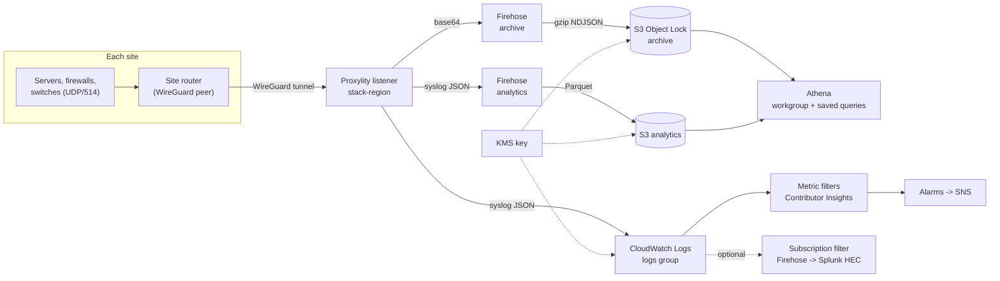

# Syslog collection over WireGuard

A multi-site syslog service built on Proxylity UDP Gateway, with no code running in AWS. Each site's router sends syslog through a WireGuard tunnel to a Proxylity listener, which fans every message out to three destinations:

- **archive**: the original bytes, unchanged, in an S3 Object Lock (WORM) bucket, as evidence.
- **logs**: parsed JSON events in CloudWatch Logs, for metrics, alarms, Logs Insights and SIEM forwarding.
- **analytics**: parsed messages as Parquet in S3, for Athena queries over the full retention period.

Everything is configured by two JSON files and deployed as one AWS CDK (TypeScript) stack, using the [Proxylity CDK constructs](https://www.npmjs.com/package/@proxylity/cdk-udp-gateway). `syslog.peers.json` is the single list of sites: the same entries become the listener's WireGuard peers, one silence alarm per site, and the per-site dashboard series.

## Architecture



| Destination | Formatter | Target | Purpose |
|---|---|---|---|
| `<stack>-<region>-archive` | `base64` | Firehose to the Object Lock bucket (gzip NDJSON) | The original bytes, kept unchanged as WORM evidence |
| `<stack>-<region>-logs` | `syslog` | CloudWatch Logs (one JSON event per message, no prefix) | Metrics, alarms, Logs Insights, SIEM subscription |
| `<stack>-<region>-analytics` | `syslog` | Firehose to the analytics bucket (Parquet) | Athena over the full retention period |

The listener is named `<stack>-<region>` and the destinations add `-archive`, `-logs` and `-analytics`. Listener and destination names must be unique in the account, so a second stack in the same region, or the same stack name in another region, doesn't collide.

### Identity on every record

The [`syslog` formatter](https://www.proxylity.com/docs/destinations/formatters.html#syslog) parses RFC 5424 and RFC 3164 messages into `Data`. The [envelope](https://www.proxylity.com/docs/destinations/json-packet-format.html) around it says who sent the message, with different levels of trust:

| Field | Meaning | Trust |
|---|---|---|
| `Remote.PeerKey` | The site's WireGuard public key | Cryptographically authenticated |
| `Remote.IpAddress` / `Port` | The site's outer (public) endpoint | Network-observed |
| `Inner.SourceAddress` / `SourcePort` | The device inside the tunnel | As reported by the site's router |
| `Data.hostname` / `app_name` | What the device says about itself | Self-reported |
| `ReceivedAt` | Proxylity's receive time (UTC) | Gateway clock |

A site's key authenticates the site: no other site can send as it. The device address in `Inner.SourceAddress` is the one the site's router puts in the packet, so read `PeerKey` + `Inner.SourceAddress` as "this device, according to that site's router". It's as trustworthy as the router. Sites can also reuse the same private addresses (192.168.1.x, for example), so always read the address together with the site. `Data.hostname` is only what the device claims; the "hostname inconsistency" query finds devices whose claims change.

## Files

```
syslog/
  syslog.config.json        settings
  syslog.peers.json         { "Peers": [ {Name, PublicKey}, ... ] }: the sites
  bin/syslog.ts             CDK app entry point (stack name, config directory, region)
  lib/
    config.ts               loads and validates both files at synth time
    names.ts                physical names, all prefixed <stack>-<region>
    security.ts             KMS key, SyslogAuditor and SyslogOperator policies
    archive.ts              Object Lock bucket, archive Firehose, optional replication
    analytics.ts            analytics bucket, Glue tables, Parquet Firehose, Athena
    queries.ts              saved Athena queries
    ingest.ts               listener, destinations, log groups, metric filters, Contributor Insights
    monitoring.ts           SNS, alarms (including one per site), dashboard
    siem.ts                 optional: subscription filter to Firehose to Splunk HEC
    firehose.ts             shared Firehose role, log group and bucket settings
    syslog-stack.ts         wires the constructs together, outputs
  scripts/
    send-test-messages.py   test traffic
```

The config files are read at synth time, so validation runs on every `cdk synth` and `cdk deploy`: bad or duplicate site keys and names, a stray `AllowedIPs` field, invalid CIDRs, invalid retention values, and stack names too long for bucket names all stop the deploy with a message. For several environments, keep one config directory per environment and select it with `-c configDir=...` (see [quick start](#quick-start)).

## Quick start

You need Node.js 20 or later, the AWS CLI with credentials for the target account, Python 3, `wg` (WireGuard tools), and a Proxylity subscription in the target account and region. On Windows, WSL2 works well for the shell commands.

1. **Create a key pair per site.** The private key stays on the site router.

   ```bash
   wg genkey | tee site1.key | wg pubkey > site1.pub
   ```

2. **Edit the two config files.** In `syslog.config.json`, set `Network.ClientCidrs` (the routers' public addresses) and `Alarms.Email`. In `syslog.peers.json`, add one entry per site with its `Name` and `PublicKey`. See [configuration](#configuration) for every setting.

3. **Install and check.** The CDK CLI is a pinned dev dependency, so `npx cdk` uses it. `cdk synth` validates the config without deploying anything. Stack names are used in bucket names, so they must be lowercase and short (at most 24 characters is safe in every region).

   ```bash
   npm ci
   export AWS_REGION=us-west-2
   npx cdk synth --quiet
   ```

4. **Deploy.** Bootstrap once per account and region, then deploy. The default stack name is `syslog`; choose another with `-c stackName=...`.

   ```bash
   npx cdk bootstrap
   npx cdk deploy
   ```

   For a second environment, keep its config files in their own directory:

   ```bash
   npx cdk deploy -c stackName=syslog-prod -c configDir=./env/prod
   ```

   Confirm the SNS email subscription when it arrives.

5. **Bring up the tunnel** on each site router using the `PeerConfig` output (see [site configuration](#site-configuration)).

   ```bash
   aws cloudformation describe-stacks --stack-name syslog --region us-west-2 \
     --query "Stacks[0].Outputs[?OutputKey=='PeerConfig'].OutputValue" --output text
   ```

6. **Send test traffic** from a host behind the tunnel, then open the `DashboardUrl` output.

   ```bash
   python3 scripts/send-test-messages.py
   ```

   The script prints a run ID, the metric increments to expect, and queries that find the messages in Logs Insights and in the archive. Firehose buffers for up to 5 minutes before objects appear in S3.

### Configuration

| Setting | Default | Meaning |
|---|---|---|
| `Network.ClientCidrs` | placeholder | Public source CIDRs of site routers. WireGuard keys authenticate peers; this adds a network-layer restriction. No traffic is accepted from outside it. |
| `Network.CollectorAddress` | `10.255.0.1` | Tunnel address sites send syslog to. Any address routed into the tunnel works. Keep it out of every site's LAN subnets: a device on that subnet would look for it locally instead of sending it to the router. |
| `Retention.LogGroupDays` | `30` | CloudWatch Logs retention for all log groups |
| `Retention.ArchiveDays` | `365` | Object Lock retention and expiration of the archive |
| `Retention.ArchiveLockMode` | `GOVERNANCE` | `GOVERNANCE` or `COMPLIANCE`. **COMPLIANCE retention can't be shortened or removed by anyone, including root.** |
| `Retention.ArchiveGlacierIrDays` | `30` | Archive transition to S3 Glacier Instant Retrieval |
| `Retention.AnalyticsDays` | `365` | Expiration of the Parquet data |
| `Retention.AnalyticsGlacierIrDays` | `0` | Analytics transition to Glacier IR (`0` disables it) |
| `Retention.AthenaResultsDays` | `7` | Expiration of query results |
| `Retention.KeyRotationDays` | `365` | KMS key rotation period |
| `Alarms.Email` | empty | Email subscribed to the alarm topic (empty for none) |
| `Alarms.PipelineSilenceSeconds` / `SiteSilenceSeconds` | `3600` | Silence windows for the pipeline and per-site alarms |
| `Alarms.FreshnessSeconds` | `900` | Firehose delivery lag that raises an alarm |
| `Ingest.LogsFilterExpression` | empty | Optional BREX filter for the logs destination only (see [cost](#cost-model)) |
| `Security.GovernanceBypassPrincipalArn` | empty | The only principal that may bypass Governance retention (empty for nobody) |
| `Security.KeyAdminPrincipalArns` | `[]` | Key administrators (existing principals) |
| `Security.ReplicaBucketArn` / `ReplicaKmsKeyArn` | empty | Optional DR replication target |
| `Siem.*` | empty | Optional Splunk HEC forwarding; an empty `HecEndpoint` leaves it out |

Each entry in `syslog.peers.json`:

| Field | Meaning |
|---|---|
| `Name` | Readable label for the site's alarm (`<stack>-<region>-site-silence-<name>`) and dashboard series. 1-32 lowercase letters, digits and hyphens. Optional; defaults to `site-<n>`, which changes if you reorder entries. |
| `PublicKey` | The site router's WireGuard public key |

### Adding a site

1. Generate a key pair for the site.
2. Add `{ "Name", "PublicKey" }` to `syslog.peers.json`.
3. Run `npx cdk deploy`.

The site's peer, silence alarm and dashboard series all come from that one entry. Renaming a site replaces its alarm.

To rotate a site's key, generate the new pair, replace `PublicKey` in the site's entry (keep its `Name`), deploy, then switch the router to the new private key. The site can't connect between the deploy and the switch, so do both in one maintenance window; its silence alarm covers you if the switch is missed.

## Site configuration

Each site router needs an address on its WireGuard interface (the examples use `10.1.255.254` for site 1, `10.2.255.254` for site 2, and so on) and a route to the collector address `10.255.0.1` through the tunnel. These addresses are your choice. Distinct tunnel addresses per site make the logs easier to read, and sites can reuse the same LAN ranges because every record carries the site's key.

### WireGuard on a Linux site router

`/etc/wireguard/syslog.conf`:

```ini
[Interface]
PrivateKey = <contents of site1.key>
Address = 10.1.255.254/32

# Paste the PeerConfig stack output here:
[Peer]
PublicKey = <listener public key>
Endpoint = <domain>.proxylity.com:<port>
AllowedIPs = 10.255.0.1/32
PersistentKeepalive = 25
```

```bash
sudo wg-quick up syslog
sudo wg show syslog latest-handshakes
```

The `AllowedIPs` line here is WireGuard's own client setting, which decides what the router sends into the tunnel; it isn't the Proxylity peer property. Only the collector address is routed into the tunnel; don't use `0.0.0.0/0` on the site side. `PersistentKeepalive = 25` keeps the tunnel visible to the tunnel-down alarm.

To forward LAN devices' syslog without changing their source address (so `Inner.SourceAddress` shows each device's own address), let the router forward UDP/514 from the LAN to the tunnel without NAT:

```bash
sudo sysctl -w net.ipv4.ip_forward=1
sudo iptables -A FORWARD -i lan0 -o syslog -p udp --dport 514 -d 10.255.0.1 -j ACCEPT
```

Devices then send to `10.255.0.1:514` directly (the router is their gateway). If devices must keep sending to an old on-premises collector address, add a DNAT rule for that address to `10.255.0.1`.

### WireGuard on OpenWrt

```bash
uci set network.syslog=interface
uci set network.syslog.proto='wireguard'
uci set network.syslog.private_key="$(cat site1.key)"
uci add_list network.syslog.addresses='10.1.255.254/32'
uci add network wireguard_syslog
uci set network.@wireguard_syslog[-1].public_key='<listener public key>'
uci set network.@wireguard_syslog[-1].endpoint_host='<domain>.proxylity.com'
uci set network.@wireguard_syslog[-1].endpoint_port='<port>'
uci set network.@wireguard_syslog[-1].persistent_keepalive='25'
uci set network.@wireguard_syslog[-1].route_allowed_ips='1'
uci add_list network.@wireguard_syslog[-1].allowed_ips='10.255.0.1/32'
uci commit network && /etc/init.d/network restart
```

Add the `syslog` interface to a firewall zone that allows forwarding from `lan` (without masquerading), and point OpenWrt's own logging at the collector with `uci set system.@system[0].log_ip='10.255.0.1'`.

### rsyslog relay with a disk-assisted queue

A relay on the site router (or a small host) receives UDP/514 from devices and forwards through the tunnel. `/etc/rsyslog.d/50-proxylity.conf`:

```
module(load="imudp")
input(type="imudp" port="514" ruleset="toProxylity")

ruleset(name="toProxylity") {
  action(type="omfwd" target="10.255.0.1" port="514" protocol="udp"
         template="RSYSLOG_SyslogProtocol23Format"
         queue.type="LinkedList" queue.filename="proxylity_fwd"
         queue.maxDiskSpace="1g" queue.saveOnShutdown="on"
         action.resumeRetryCount="-1" action.resumeInterval="10")
}
```

Trade-off: a relay re-sends messages from its own address, so `Inner.SourceAddress` becomes the relay rather than each device, and device identity falls back to the self-reported `hostname`. Use routing (above) when you want a per-device address in every record, and a relay when you need buffering.

### Firewalls, switches and other devices

Point the device's remote syslog server at `10.255.0.1` UDP/514 (routed setup) or at the relay's LAN address. Prefer RFC 5424 output where the device offers it, include the hostname, and keep device clocks on NTP. RFC 3164 timestamps have no year or time zone; use `ReceivedAt` for time-based analysis.

## Delivery semantics

- UDP syslog is lossy, and WireGuard doesn't retransmit. A packet lost between a device and the gateway is gone.
- After the gateway, delivery is buffered and retried by Proxylity and Firehose, and failures show up in the `Errors` metrics and the errors log group.
- The completeness and cross-check queries only find gaps after ingestion. They can't see loss before the gateway.
- Sites that need stronger delivery should run the rsyslog relay with a disk queue. That protects against relay restarts and local send failures (for example, the tunnel interface being down). It can't detect loss on the far side of a UDP send.

## Alarms

All alarms publish to the `AlarmTopicArn` topic and are named `<stack>-<region>-...`.

| Alarm | Fires when | Missing data |
|---|---|---|
| `high-severity` | Any message with severity 2 (crit) or lower in 5 minutes | not breaching |
| `pipeline-silence` | No messages from any site in `PipelineSilenceSeconds` | breaching |
| `site-silence-<name>` | No messages from that site in `SiteSilenceSeconds` (one per entry in `syslog.peers.json`) | breaching |
| `tunnel-down` | No listener protocol traffic (handshakes, keepalives) for 2 × 5 minutes | breaching |
| `parse-failures` | Any message with `parse_ok` false in 5 minutes | not breaching |
| `listener-errors`, `<dest>-destination-errors` | Proxylity reports errors for the listener or a destination | not breaching |
| `archive-freshness`, `analytics-freshness` | Firehose `DeliveryToS3.DataFreshness` over `FreshnessSeconds` | not breaching |
| `failed-conversion` | Firehose `FailedConversion.Records` above zero | not breaching |

The silence and tunnel-down alarms are in alarm right after deployment, until traffic flows. Each unparseable message is also reported by the formatter as a destination error, so it counts once in the `Errors` metric of the logs and analytics destinations. Expect the `parse-failures` and both destination-errors alarms together when a device sends non-syslog data.

Reading the silence alarms together:

| Site silence | Tunnel down | Likely cause |
|---|---|---|
| One site | No | That site's tunnel is down, or its devices stopped logging |
| All sites | Yes | Listener or connectivity problem |
| All sites | No | Devices stopped sending, or the logs destination is failing (check `logs-destination-errors`) |

`tunnel-down` is listener-wide: Proxylity listener metrics aren't per peer, so with several sites it only fires when every tunnel is down. With one site, stopping its peer fires both its site-silence alarm and tunnel-down.

## Dashboard and metrics

The `DashboardUrl` output opens a dashboard with:

- **Alarms:** status widgets for every pipeline alarm and every site alarm.
- **Syslog content:** message volume, a severity breakdown, parse failures.
- **Sites:** `SiteMessageCount` per site, labeled with the site's `Name`. Above 50 sites the graph switches to a `SEARCH` expression over the `PeerKey` dimension.
- **Listener:** handshake and keepalive volume, and `Errors` for the listener and each destination.
- **Destinations:** `IngressBytes`, `IngressPackets` and `FilteredPackets` per destination. Proxylity packet counts are [size-weighted](https://www.proxylity.com/docs/metrics.html), not raw datagram counts.
- **Firehose, both streams:** records in and delivered, delivery success, freshness, Parquet conversion.
- **Logs Insights:** recent high severity, messages by site and device, messages by hostname.

Syslog metrics come from metric filters on the logs group, in namespace `Syslog/<stack>-<region>`:

| Metric | Filter | Dimension |
|---|---|---|
| `MessageCount` | `{ $.Formatter = "syslog" }` | none |
| `HighSeverityCount` | `{ $.Data.severity <= 2 }` | none |
| `SeverityCount` | `{ $.Data.severity >= 0 }` | `Severity` = `$.Data.severity_name` |
| `ParseFailureCount` | `{ $.Data.parse_ok IS FALSE }` | none |
| `SiteMessageCount` | `{ $.Formatter = "syslog" }` | `PeerKey` = `$.Remote.PeerKey` |

Proxylity listener and destination metrics are in `Proxylity/UDP Gateway` with the `Listener` or `Destination` dimension set to the names above. Three Contributor Insights rules (`-top-sites`, `-top-devices`, `-top-hosts-apps`) rank the busiest sites, devices, and host and app pairs.

## Athena

The Glue database (`<stack>_<region>` with hyphens as underscores) has two tables, both with partition projection, so there are no crawlers or partition loads.

- **`syslog`**: the analytics data as Parquet. Columns are the envelope (`receivedat`, `ingressregion`, `remote`, `local`, `inner`, `formatter`) plus `data` as a struct of the formatter's fields (schema_version 1), with `structured_data` as `map<string,map<string,string>>`. Partitions are `analytics/dt=yyyy-MM-dd/hr=HH/`.
- **`syslog_archive`**: a thin table over the archive's gzip NDJSON. `data` is the original message as base64; `from_utf8(from_base64(data))` decodes it. Partitions are `archive/dt=yyyy-MM-dd/hr=HH/`.

Notes on the schema:

- `dt` and `hr` are Firehose arrival time (UTC), a few minutes after `receivedat`. Filter on `dt` to limit the data scanned, and on `receivedat` for exact windows.
- `inner` is a reserved word in SQL; quote it as `"inner".sourceaddress`.
- Firehose's JSON deserializer is case-insensitive and lowercases keys, so `structured_data` SD-IDs and parameter names are lowercase in the Parquet table. The archive keeps the original bytes.
- The formatter only adds fields over time (`schema_version` stays compatible). When it adds a field, add the column to the `syslog` table's `data` struct to start converting it.

The `<stack>-<region>` workgroup has these saved queries:

| Table | Query |
|---|---|
| `syslog` | High severity in the last 24 hours |
| `syslog` | Top sites and devices |
| `syslog` | Volume by hour and severity |
| `syslog` | Parse failures by device |
| `syslog` | Hostname inconsistency per device |
| `syslog_archive` | Evidence scoping: the `"$path"` objects for a site, device and window |
| `syslog_archive` | Completeness per site per hour, including empty hours |
| `syslog_archive` | Decoded lookup |
| both | Archive vs analytics hourly count cross-check |

## Security and separation of duties

| Control | Implementation |
|---|---|
| Encryption in transit | WireGuard from each site; TLS required on every bucket (`aws:SecureTransport`) |
| Encryption at rest | One customer managed KMS key for the buckets and all log groups, with rotation |
| Immutability | S3 Object Lock on the archive, default retention `ArchiveDays` in `ArchiveLockMode` |
| Least privilege | Separate roles per Firehose stream, for Proxylity delivery, and for listener metrics; metrics limited to `Proxylity/UDP Gateway` |
| Separation of duties | `SyslogAuditor` and `SyslogOperator` managed policies, a governance bypass principal, and key administrators |

**KMS key policy.** CloudWatch Logs may use the key only for log groups under this stack's prefix (`kms:EncryptionContext:aws:logs:arn`, principal `logs.<region>.amazonaws.com`). The S3 and Firehose statements are limited with `aws:SourceAccount` and `aws:SourceArn` to this stack's buckets and streams. `KeyAdminPrincipalArns` get administrative actions only, not encrypt or decrypt. The account-root statement stays: it's what lets IAM policies in the account manage the key at all, and without it a mistake in the key policy could make the key unmanageable and the archive unreadable. The key is retained when the stack is deleted, because the retained archive needs it.

**Governance bypass.** The archive bucket policy denies `s3:BypassGovernanceRetention`, `s3:PutObjectRetention` and `s3:PutBucketObjectLockConfiguration` to everyone except `GovernanceBypassPrincipalArn` (nobody when it's empty). This only matters in GOVERNANCE mode: in COMPLIANCE mode nobody can shorten retention anyway, so the bypass principal has no extra power. Because lock settings are denied too, CloudFormation can't change `ArchiveDays` or `ArchiveLockMode` later either (see [operations](#operations)).

**SyslogAuditor** (`AuditorPolicyArn` output) can run Athena queries in the workgroup, read the Glue tables, read the archive and analytics buckets (including object versions and retention), decrypt with the key, write Athena results, and run Logs Insights on this stack's log groups. An explicit deny blocks deleting objects, changing retention, lifecycle or bucket policies, and changing the catalog, log groups or key.

**SyslogOperator** (`OperatorPolicyArn` output) can view dashboards, metrics, alarms and Contributor Insights, enable or disable this stack's alarm actions, and see Firehose and SNS status. An explicit deny blocks reading syslog content (S3 objects, log events, Logs Insights, Athena results, KMS decrypt).

To validate: attach `SyslogAuditor` to a test role, run a saved query, then try `aws s3api delete-object --bucket <archive> --key <key> --version-id <id> --bypass-governance-retention`; it fails with AccessDenied. Try the same as any principal other than the bypass principal; it also fails.

## SIEM forwarding (optional)

Setting `Siem.HecEndpoint` adds the SIEM forwarding resources (`lib/siem.ts`): a subscription filter on the logs group sends events to a Firehose stream that delivers to Splunk HEC. Firehose decompresses the CloudWatch Logs batches and extracts each log message, so Splunk receives one event per syslog message, already as the JSON request packet (site, device and parsed fields). Failed events are backed up to an S3 bucket.

1. Create a HEC token in Splunk and store it in Secrets Manager. The secret value must be a JSON object with a `hec_token` key. If the secret uses its own KMS key, allow the Firehose role to decrypt with it.

   ```bash
   aws secretsmanager create-secret --name syslog/splunk-hec \
     --secret-string '{"hec_token":"<token>"}' --region us-west-2
   ```

2. Set `Siem.HecEndpoint` (the HEC URL, HTTPS with a publicly trusted certificate), `HecTokenSecretArn`, and optionally `SubscriptionFilterPattern` (for example `{ $.Data.severity <= 4 }`), then deploy again.

3. In Splunk, give the token a source type for these events and extract the JSON fields at search time:

   ```
   # props.conf
   [proxylity:syslog]
   KV_MODE = json
   TIME_PREFIX = "ReceivedAt":"
   TIME_FORMAT = %Y-%m-%dT%H:%M:%S
   TZ = UTC
   ```

   Search with `sourcetype=proxylity:syslog Data.severity<=2 | table ReceivedAt Remote.PeerKey Inner.SourceAddress Data.hostname Data.message`.

The same construct is the model for other SIEMs: replace `splunkDestinationConfiguration` with an `httpEndpointDestinationConfiguration` for Elastic, Datadog, Sumo Logic and others that accept Firehose HTTP endpoint delivery.

## Cost model

Monthly estimates, assuming 250-byte messages (about 4 million messages per GB), every message delivered to all three destinations, Proxylity's published pay-as-you-go rates, AWS us-east-1 list prices at the time of writing, 30-day CloudWatch retention and 365-day S3 retention at steady state. Check current [Proxylity](https://www.proxylity.com/pricing.html) and AWS pricing; these are for sizing, not quotes.

| Item | 1 GB/day | 10 GB/day | 100 GB/day |
|---|---|---|---|
| Messages per month | 120 M | 1.2 B | 12 B |
| Proxylity (3 deliveries per message, tiered per-million rates) | ~$415 | ~$3,710 | ~$32,400 |
| CloudWatch Logs ingestion ($0.50/GB, events ~4× raw size) | ~$60 | ~$600 | ~$6,000 |
| Contributor Insights (3 rules, $0.02 per million events per rule) | ~$9 | ~$74 | ~$720 |
| Firehose, both streams, including Parquet conversion | ~$8 | ~$83 | ~$830 |
| S3 Standard + Glacier IR (archive and Parquet) | ~$2 | ~$21 | ~$210 |
| Athena (depends on queries; ~0.1 TB scanned per GB/day) | ~$1 | ~$5 | ~$50 |
| Fixed: custom metrics, alarms, dashboard, KMS | ~$20 | ~$20 | ~$20 |

At these message sizes, Proxylity's per-packet charge is the largest item, because each message counts once per destination. CloudWatch Logs ingestion is the largest AWS item: each JSON event carries the envelope and parsed fields, roughly four times the raw message. For sustained volumes at the higher end, Proxylity's prepaid credits or Enterprise pricing change the first row substantially.

A PRI `FilterExpression` on the logs destination lowers both: filtered packets aren't charged by Proxylity and never reach CloudWatch, while the archive and analytics destinations still receive everything. This [BREX](https://www.proxylity.com/docs/destinations/brex-syntax.html) expression keeps severity 4 (warning) or worse, plus anything that doesn't start with a PRI, and drops notice, info and debug:

```
(u8[0] ?? 0) != 60 || (((u8[2] ?? 0) == 62 ? (u8[1] ?? 0) - 48 : (u8[3] ?? 0) == 62 ? ((u8[1] ?? 0) - 48) * 10 + (u8[2] ?? 0) - 48 : ((u8[1] ?? 0) - 48) * 100 + ((u8[2] ?? 0) - 48) * 10 + (u8[3] ?? 0) - 48) % 8 <= 4)
```

Put it in `Ingest.LogsFilterExpression`. It reads the one to three PRI digits after `<`, takes the severity (PRI modulo 8), and uses `??` so short packets don't fail evaluation. With a filter, the content metrics and site-silence alarms only count what reaches CloudWatch, so a site that only sends info messages will look silent; raise `SiteSilenceSeconds` or keep the site's logs unfiltered. Contributor Insights rules can also be disabled if you don't use them.

## Compliance mapping

This architecture supports common log-management controls. It isn't a certification, and assessors look at your whole environment and procedures.

| Framework | Control | How this example helps |
|---|---|---|
| PCI DSS v4.0 | 10.5.1: retain audit logs at least 12 months, with the last three months immediately available | The defaults keep 365 days. Glacier Instant Retrieval serves objects in milliseconds, so the whole year stays immediately available. |
| PCI DSS v4.0 | 10.3.1–10.3.3: limit read access, protect logs from modification, keep them on a central server | Auditor and operator policies, Object Lock archive, KMS encryption, one collection point |
| NIST SP 800-92 | Centralized log management, protection, retention and analysis | One collection point per region, WORM archive, retention settings, alarms and Athena |
| ISO/IEC 27001:2022 | A.8.15 Logging | Logs are produced centrally, stored, protected, and analysed |
| SOC 2 | CC7.2, CC7.3: monitor system components and evaluate anomalies | Alarms, dashboard, Contributor Insights, optional SIEM forwarding |

## Disaster recovery

Set `Security.ReplicaBucketArn` and `ReplicaKmsKeyArn` to replicate new archive objects into an Object Lock bucket in another region. Deploy that bucket separately in the DR region, with versioning, Object Lock and a KMS key, for example:

```bash
aws s3api create-bucket --bucket syslog-us-west-2-archive-replica-<account> --region us-east-2 \
  --create-bucket-configuration LocationConstraint=us-east-2 --object-lock-enabled-for-bucket
```

Replicas keep each object's retention settings and are stored as Glacier IR. Replication covers objects written after it's enabled; use S3 Batch Replication for older objects. Replication protects the evidence, not ingestion: the analytics data, log groups and alarms stay in the primary region.

## Operations

- **Interpreting alarms:** use the [alarm matrix](#alarms). The errors log group (`ErrorsGroupName` output) has the details behind every `Errors` alarm.
- **Deleting the stack:** the archive bucket and the KMS key are retained (`DeletionPolicy: Retain`) and Object Lock keeps the archived data until each object's retention expires. Empty the analytics, Athena results and SIEM backup buckets first, or their deletion fails:

  ```bash
  aws s3 rm s3://syslog-us-west-2-analytics-<account> --recursive
  aws s3 rm s3://syslog-us-west-2-athena-<account> --recursive
  npx cdk destroy
  ```

  In GOVERNANCE mode the bypass principal can remove archived objects early with `--bypass-governance-retention`. In COMPLIANCE mode nobody can.
- **Rotating peer keys:** see [adding a site](#adding-a-site).
- **Changing retention:** the archive bucket policy blocks CloudFormation from changing lock settings too. CloudFormation acts as the CDK bootstrap execution role (`cdk-hnb659fds-cfn-exec-role-<account>-<region>`), not as you, so deploying with the bypass principal's credentials doesn't help. Change retention in three deploys: remove the `OnlyBypassPrincipalChangesRetention` statement in `lib/archive.ts` and deploy, change `ArchiveDays` or `ArchiveLockMode` and deploy, then restore the statement and deploy. (One deploy can't do it, because CloudFormation updates the bucket before its policy.) Lengthening retention only affects new objects; existing objects keep the retention they were written with.

## Validation checklist

After deploying, run `scripts/send-test-messages.py` and check:

- Every metric increments as the script predicts, including each `SeverityCount` value and `SiteMessageCount` for each peer. `HighSeverityCount` should not count the unparseable message (its `severity` is null).
- The archive holds the messages byte for byte (the decoded lookup query with the run ID).
- The analytics Parquet is queryable, and the cross-check query shows no difference once both streams have flushed.
- Proxylity metrics appear under the listener and destination names.
- Stopping one peer fires its site-silence alarm (and tunnel-down, with a single peer).
- Adding a second site to `syslog.peers.json` adds its peer, alarm and dashboard series after deploying.
- A second stack in the same region, and the same stack name in another region, deploy without name collisions.
- The auditor and bypass permissions behave as described in [security](#security-and-separation-of-duties).
- With the SIEM stack enabled, events reach a test HEC endpoint.

## Variants and feature requests

- OCSF / Security Lake mapping, as a separate construct.
- Syslog relay to an on-premises collector, using a Packet Source with `Formatter: syslog`.
- Proxylity feature requests:
  - Per-peer listener metrics, for tunnel-down detection per site.
